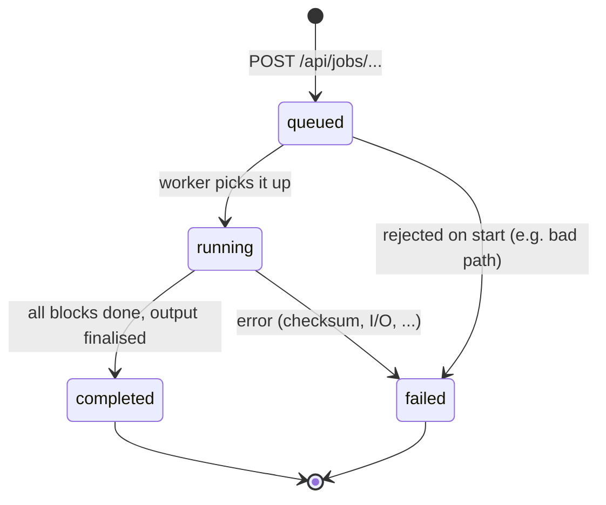

# Progress States (Frontend / Backend)

Owner: Manasa K (FR-14, FR-15). Day 2.
Source: SAD 3.5 (ADR-07), 4.3.1, 4.4, 4.5, api-contract.md.
Items marked PROPOSED are not in the SAD yet and need the team's OK.

## 1. The four states

A job is created by `POST /api/jobs/{compress|extract|verify}` and read with
`GET /api/jobs/{id}`. `state` is always one of:

| State | Meaning | `progress` | Extra fields | Terminal |
| --- | --- | --- | --- | --- |
| queued | Accepted, not started yet (waiting for a worker or another job) | 0.0 | none | no |
| running | Blocks are being processed | 0.0 to below 1.0, never goes down | none | no |
| completed | Finished successfully | 1.0 | `result` | yes |
| failed | Stopped with an error | last value reached | `error` | yes |



No cancelled state in v1 (SAD 4.6). It can be added later without changing
the archive format.

## 2. How `progress` is calculated (FR-14)

Progress is based on completed blocks (Execution Plan, Day 13).

| Operation | progress = |
| --- | --- |
| compress | blocks finished / total blocks |
| extract | blocks decoded and written / blockCount in the archive |
| verify | blocks checked / blockCount in the archive |

Rules:

1. `progress` is between 0.0 and 1.0 and never decreases.
2. It stays 0.0 while queued and while the input is being enumerated
   (total block count not known yet).
3. PROPOSED: while running it is capped at 0.99. The last steps (SHA-256,
   temp file rename, SAD 4.4) happen after the last block, so the bar must
   not sit at 100% while the job is still running. `1.0` appears only with
   `completed`.
4. On `failed`, `progress` keeps the last value. Partial output is removed
   (SAD 4.4).
5. `info` is not a job. It is one synchronous `GET /api/archives/info`.

## 3. What each state shows in the UI

| State | Screen | Text | Notes |
| --- | --- | --- | --- |
| queued | Progress | "Waiting to start..." | bar at 0, no percentage change |
| running | Progress | "Compressing... 42%" (or Extracting / Checking) | bar + percentage + elapsed time |
| completed | Result | "Done" + statistics (compress), files restored (extract), "Archive is OK" (verify) | focus moves to the heading |
| failed | Error | "Something went wrong" + `userMessage` | `role="alert"`; no code, no stack trace |

The state is always written as text. It is never shown by colour alone
(SAD 4.5 accessibility). The elapsed time is counted in the browser from the
moment the job is accepted; the final `elapsedMs` comes from the result.

## 4. Polling behaviour (ADR-07)

- Poll every 500 ms while the state is `queued` or `running`.
- Stop polling on `completed` or `failed`.
- PROPOSED: schedule the next poll only after the previous response has
  arrived (chained `setTimeout`, not `setInterval`). A slow response must not
  create overlapping requests. Day 1 `app.js` uses `setInterval`; fix on Day 13
  when progress is wired to the real backend.
- PROPOSED: if the request fails (network error), retry up to 3 times in a row,
  then show the error screen with the E_INTERNAL message.
- `404 E_NOT_FOUND` for the job id (server restarted, job table is in memory,
  SAD 3.6): show the E_INTERNAL message, not the "file or folder" message.
  See `error-categories.md` section 5, row 8.
- The page stays usable while polling (NFR-08, TC-UI-05): no blocking calls.

## 5. Job lifetime (PROPOSED)

- The Job Manager keeps job state in memory only (no database).
- A finished job stays readable until the server stops, so a page refresh
  can still fetch its result.
- One job at a time from the UI; the backend may hold more in `queued`.

## 6. Example responses

```
GET /api/jobs/j-0007            queued
{ "state": "queued", "progress": 0.0 }

GET /api/jobs/j-0007            running
{ "state": "running", "progress": 0.42 }

GET /api/jobs/j-0007            completed (verify, PROPOSED result shape)
{ "state": "completed", "progress": 1.0,
  "result": { "status": "ok", "filesChecked": 12, "blocksChecked": 700 } }

GET /api/jobs/j-0007            failed
{ "state": "failed", "progress": 0.6,
  "error": { "code": "E_BLOCK_CHECKSUM", "message": "block 213 CRC32 mismatch",
             "userMessage": "This archive is corrupted and cannot be extracted safely.",
             "details": { "block": 213 } } }
```

Note: api-contract.md (Day 1) shows `failed` without `progress`. It is optional
on `failed`; the UI must not depend on it.

## 7. Test mapping

| Behaviour | Test cases |
| --- | --- |
| queued, running, completed in order | TC-API-01 |
| failed with E_PERMISSION / E_IO | TC-API-03 |
| progress bar and result screen | TC-UI-03 |
| plain-language failure | TC-UI-04 |
| page responsive during a job | TC-UI-05 |
